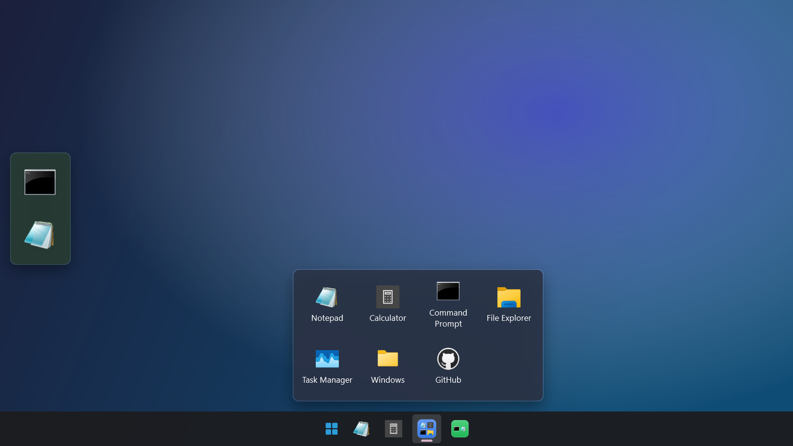
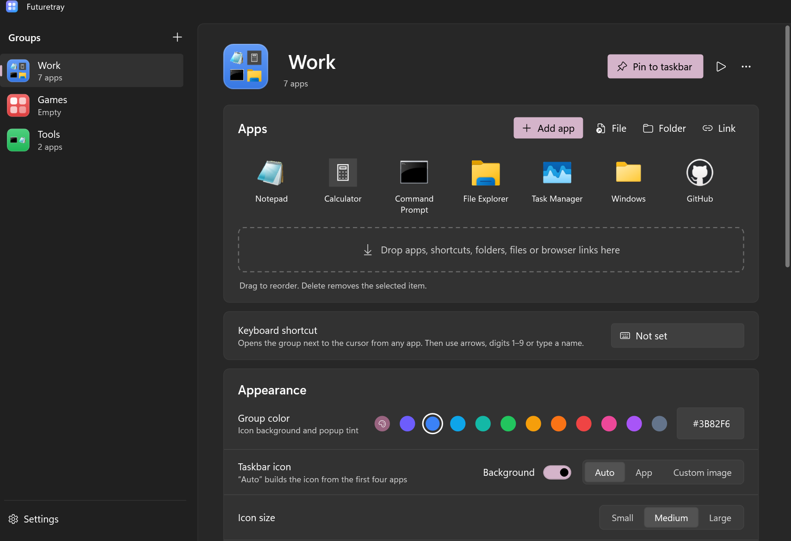
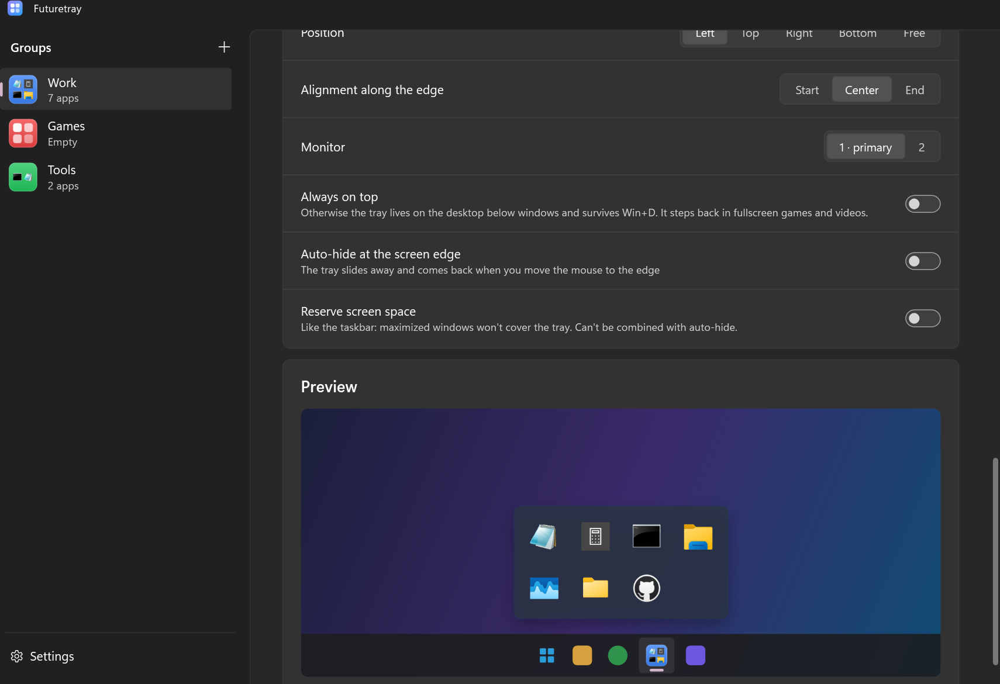
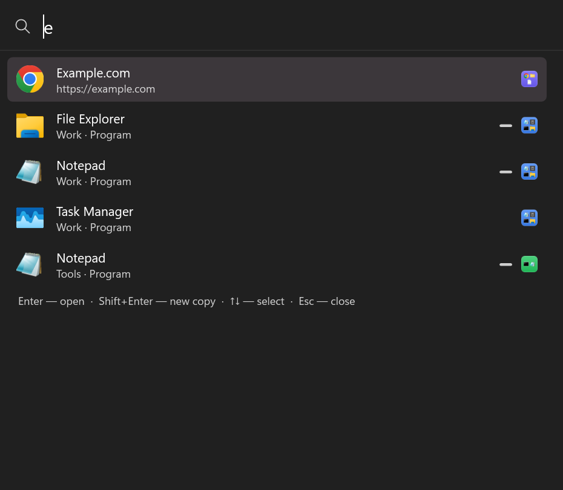
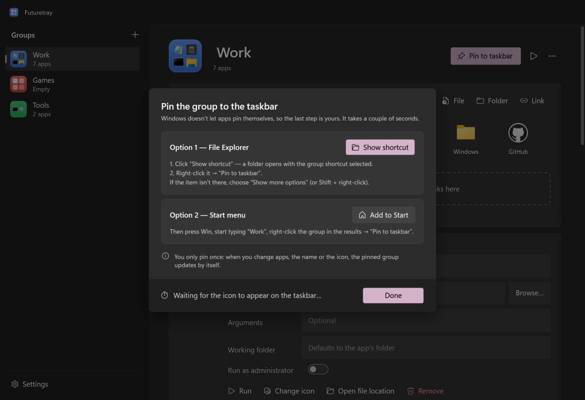
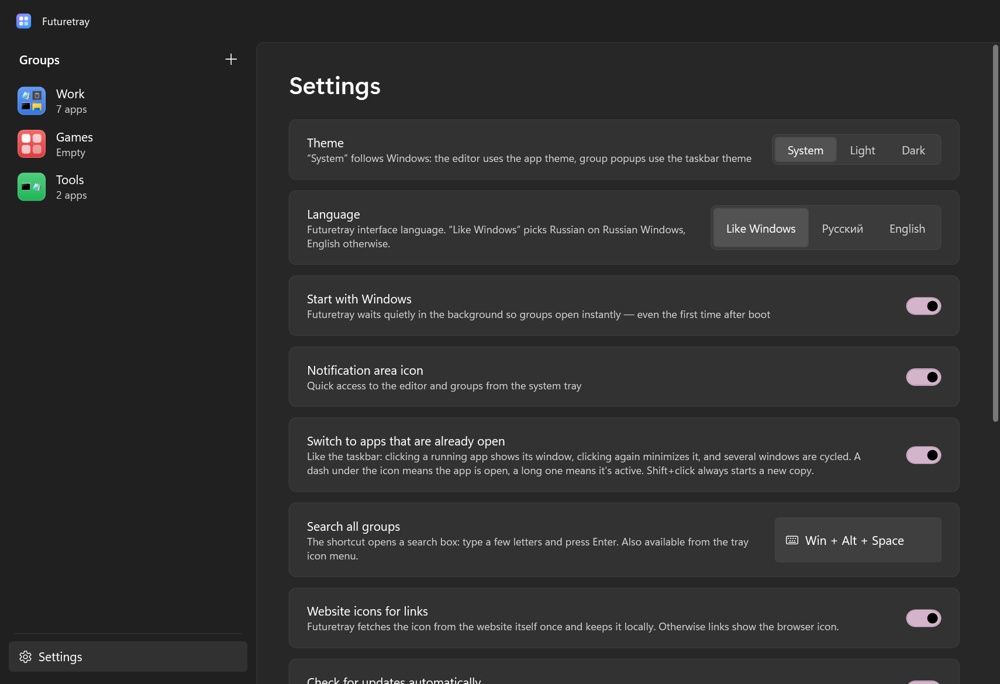

# Futuretray

[](https://github.com/Nyan4eg/Futuretray/actions/workflows/ci.yml)
[](https://github.com/Nyan4eg/Futuretray/releases/latest)
[](LICENSE)

[Русский](README.md) · **English**

App groups on the Windows taskbar — a fast, good-looking alternative to
[taskbar-groups](https://github.com/tjackenpacken/taskbar-groups).
One taskbar icon → click → a tidy popup with your apps, folders and websites.



## Install

Download `FuturetraySetup-<version>.exe` from the [latest release](https://github.com/Nyan4eg/Futuretray/releases/latest)
and run it — no admin rights needed. Futuretray keeps itself up to date after that.

> On first run Windows SmartScreen may warn about an unknown publisher, because the app isn't signed with a paid
> certificate. Click “More info” → “Run anyway”.

## How to use

1. **Create a group** → “Add app” (or just drop files onto the window).
2. **Pin it to the taskbar** → “Show shortcut” → right-click the selected shortcut → “Pin to taskbar”.
   The dialog notices by itself when the icon shows up.
3. Click the icon to open the group.



In the popup: click to launch, **Ctrl+click** keeps it open, **Shift+click** or middle click opens a new copy,
**1–9** launch the N-th app, typing searches, right-click offers run as administrator, file location and “Open all”.

## Features

- **Instant**: ~120 ms from click to popup — a background process waits, the shortcut only sends it a command.
- **Correct placement** next to the taskbar on any side, any monitor and scale, with auto-hide.
- **Windows 11 look**: Acrylic/Mica, rounded corners, animations, light and dark themes, English and Russian UI.
- **Group icon** built from the apps' icons (like an iPhone folder) or your own image, in any color.
  The pinned icon updates by itself — no need to re-pin.
- **Like the taskbar**: a dash under running apps, and clicking a running app switches to its window.
- **Jump list**: right-click a pinned group to see its apps in the native Windows menu.
- **Workspaces**: “Remember layout”, and “Open all” puts every window back in its place, across monitors. A separate layout for each monitor setup, launch order with delays, and opening a group when you sign in.
- **Search everywhere** (Win+Alt+Space): group apps, open windows and Start menu apps; Ctrl+Enter adds a result to a group.
- **Finish and switch**: “Close all of the group's apps”, a “Minimize everything else” focus mode, and “Open all” can minimize the rest or close other groups.
- **Desktop tray**: show any group as its own bar at a screen edge or anywhere you like — always on top,
  auto-hiding, or reserving screen space. Drop a file onto an app in the tray to open it there.
- **Keyboard**: a shortcut per group and **Win+Alt+Space** to search all groups.
- **Adding apps**: everything from Start (including Microsoft Store apps), drag and drop of files, folders and links,
  website icons for links, and **folder groups** that pick up new files automatically.
- **Move from Taskbar Groups** in one click, plus export and import of groups.
- **Reliable**: auto-updates with checksum verification, a “Create report” button, broken settings repair themselves.

| Desktop tray | Search across groups |
|---|---|
|  |  |

| Pinning | Settings |
|---|---|
|  |  |

## Compared to taskbar-groups

| | taskbar-groups | Futuretray |
|---|---|---|
| Speed | starts .NET Framework on every click | ~120 ms |
| Popup position | breaks with a left, right or top taskbar | any side, monitors, scaling |
| Adding apps | pick an exe only | Start menu, Store, drag and drop, links, folders |
| After changes | pin again | updates by itself |
| Errors | crashes on start (`ArgumentOutOfRangeException`) | data is repaired, errors go to a log |
| Control | mouse | hotkeys, search, digits 1–9 |

## Where data lives

- Settings and groups: `%APPDATA%\Futuretray\config.json` (+ `.bak`)
- Group shortcuts and icons: `%APPDATA%\Futuretray\Shortcuts`, `…\Icons`
- Error log: `%LOCALAPPDATA%\Futuretray\logs\futuretray.log`

## For developers

Requires the .NET 9 SDK (and Inno Setup 6 for the installer).

```bash
dotnet test
```

```bash
pwsh tools/release.ps1
```

`release.ps1` builds `dist/Futuretray.exe` (single file, no .NET install needed), `dist/Futuretray.zip`
and the installer `dist/FuturetraySetup-<version>.exe`.

**Releasing**: add a `## X.Y.Z` section to `CHANGELOG.md`, bump `<Version>` in `src/Futuretray/Futuretray.csproj`, then tag:

```bash
git tag v1.4.0
```

```bash
git push origin main --tags
```

GitHub Actions runs the tests, builds the installer and publishes the release; installed copies offer to update.

**Translations**: the Russian text in code and XAML is the key (`Loc.T("…")`, `{ui:T '…'}`), English lives in
`src/Futuretray/Core/English.cs`. Tests block a release if any UI string lacks a translation.

## License

[GPL-3.0](LICENSE). Futuretray is inspired by [taskbar-groups](https://github.com/tjackenpacken/taskbar-groups) but written from scratch.
