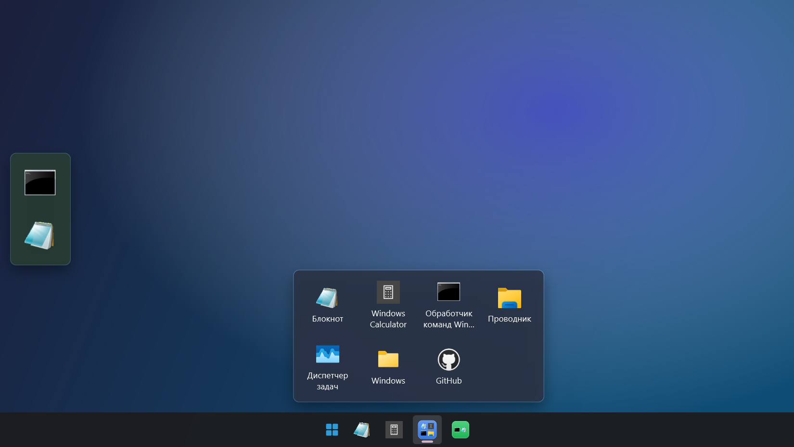
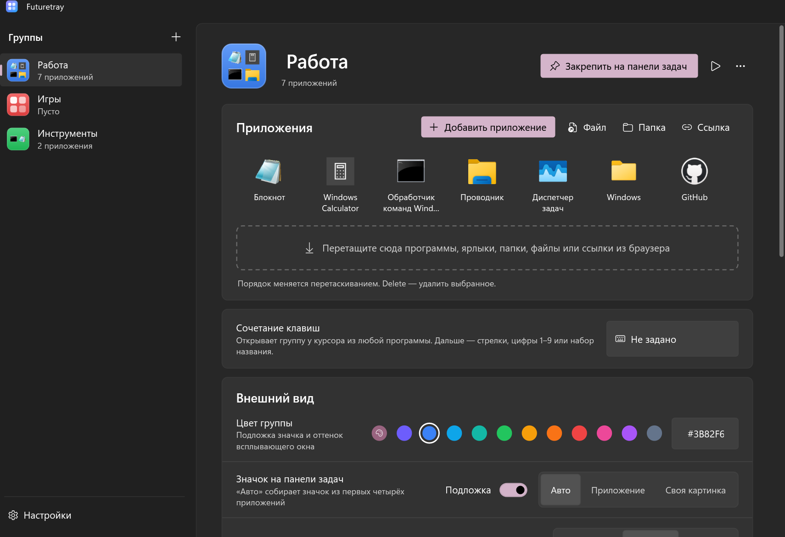
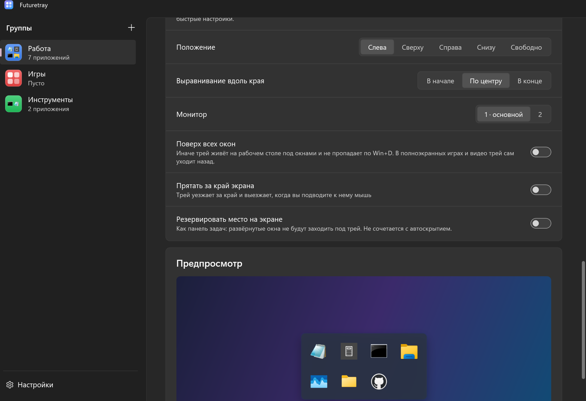
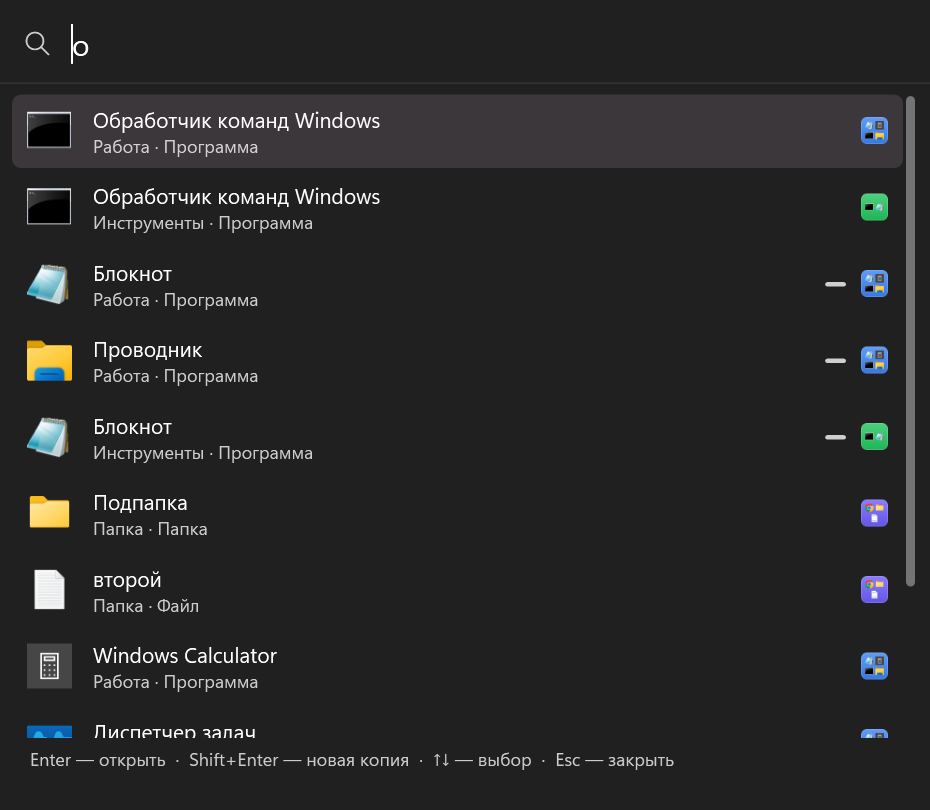
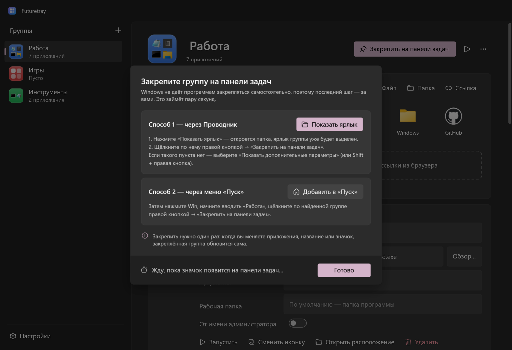
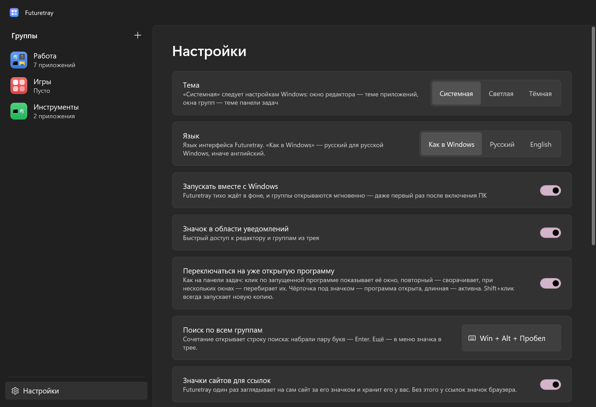

# Futuretray

[](https://github.com/Nyan4eg/Futuretray/actions/workflows/ci.yml)
[](https://github.com/Nyan4eg/Futuretray/releases/latest)
[](LICENSE)

**Русский** · [English](README.en.md)

Группы приложений на панели задач Windows — быстрая и красивая альтернатива
[taskbar-groups](https://github.com/tjackenpacken/taskbar-groups).
Один значок на панели задач → клик → аккуратное окно с вашими программами, папками и сайтами.



## Установка

Скачайте `FuturetraySetup-<версия>.exe` со страницы [последнего релиза](https://github.com/Nyan4eg/Futuretray/releases/latest)
и запустите — права администратора не нужны. Дальше программа обновляется сама.

> При первом запуске Windows SmartScreen может предупредить о неизвестном издателе: программа не подписана
> платным сертификатом. Нажмите «Подробнее» → «Выполнить в любом случае».

## Как пользоваться

1. **Создайте группу** → «Добавить приложение» (или просто перетащите файлы в окно).
2. **Закрепите на панели задач** → «Показать ярлык» → правой кнопкой по выделенному ярлыку → «Закрепить на панели задач».
   Окно само заметит, что значок появился на панели.
3. Клик по значку открывает группу.



Во всплывающем окне: клик — запустить, **Ctrl+клик** — не закрывать окно, **Shift+клик** или средняя кнопка —
новая копия, **1–9** — N-е приложение, набор текста — поиск, правая кнопка — запуск от администратора,
расположение файла, «Открыть все».

## Возможности

- **Мгновенно**: ~120 мс от клика до окна — в фоне ждёт процесс, ярлык лишь передаёт ему команду.
- **Правильное положение** у панели задач с любой стороны, на любом мониторе и масштабе, с автоскрытием.
- **Windows 11**: Acrylic/Mica, скругления, анимации, светлая и тёмная тема, русский и английский интерфейс.
- **Значок группы** собирается из иконок приложений (как папка на iPhone) или берётся свой, любого цвета.
  Закреплённый значок обновляется сам — перезакреплять не нужно.
- **Как на панели задач**: чёрточка под открытыми программами, клик переключает на уже открытое окно.
- **Трей на рабочем столе**: любая группа — отдельной панелью у края экрана или в свободном месте;
  поверх окон, с автоскрытием или с резервированием места. Файл, брошенный на значок, откроется в этой программе.
- **Клавиатура**: своё сочетание для каждой группы и **Win+Alt+Space** — поиск по всем группам.
- **Добавление**: все приложения из «Пуска» (включая Microsoft Store), перетаскивание файлов, папок и ссылок,
  значки сайтов у ссылок, **группа-папка**, которая сама подхватывает новые файлы.
- **Переезд с Taskbar Groups** в один клик, экспорт и импорт групп.
- **Надёжность**: автообновление с проверкой контрольной суммы, кнопка «Собрать отчёт», битые настройки чинятся сами.

| Трей на рабочем столе | Поиск по группам |
|---|---|
|  |  |

| Закрепление | Настройки |
|---|---|
|  |  |

## Что лучше, чем в taskbar-groups

| | taskbar-groups | Futuretray |
|---|---|---|
| Скорость | запуск .NET Framework при каждом клике | ~120 мс |
| Положение окна | ломается при панели слева, справа, сверху | любая сторона, мониторы, масштаб |
| Добавление программ | только выбор exe | «Пуск», Store, перетаскивание, ссылки, папки |
| После изменений | перезакреплять заново | обновляется само |
| Ошибки | падает при запуске (`ArgumentOutOfRangeException`) | данные чинятся, ошибки — в журнал |
| Управление | мышь | горячие клавиши, поиск, цифры 1–9 |

## Где лежат данные

- Настройки и группы: `%APPDATA%\Futuretray\config.json` (+ `.bak`)
- Ярлыки и значки групп: `%APPDATA%\Futuretray\Shortcuts`, `…\Icons`
- Журнал ошибок: `%LOCALAPPDATA%\Futuretray\logs\futuretray.log`

## Для разработчиков

Нужен .NET 9 SDK (для установщика — ещё Inno Setup 6).

```bash
dotnet test
```

```bash
pwsh tools/release.ps1
```

`release.ps1` собирает `dist/Futuretray.exe` (один файл, .NET ставить не нужно), `dist/Futuretray.zip`
и установщик `dist/FuturetraySetup-<версия>.exe`.

**Выпуск версии**: раздел `## X.Y.Z` в `CHANGELOG.md`, `<Version>` в `src/Futuretray/Futuretray.csproj`, затем тег:

```bash
git tag v1.4.0
```

```bash
git push origin main --tags
```

GitHub Actions прогонит тесты, соберёт установщик и опубликует релиз; установленные копии предложат обновиться.

**Перевод**: русский текст в коде и XAML — ключ (`Loc.T("…")`, `{ui:T '…'}`), английский — в
`src/Futuretray/Core/English.cs`. Тесты не дают выпустить версию со строкой без перевода.

**Как устроено**:

- `Program.cs` — точка входа: если фоновый хост уже работает, команда уходит ему по именованному каналу,
  и процесс сразу завершается (WPF при этом даже не загружается).
- Ярлык группы — `Futuretray.exe --group <id>` с уникальным AppUserModelID, поэтому Windows не склеивает группы.
- `Core/TaskbarInfo.cs` — сторона панели задач и положение окна; `Core/RunningApps.cs` — какие программы открыты;
  `Core/ShortcutManager.cs` — ярлыки и значки групп; `UI/` — окна.
- Отладка: `Futuretray.exe --snapshot <папка>` (только Debug) рисует окна в PNG — так сделаны скриншоты выше.

## Лицензия

[GPL-3.0](LICENSE). Futuretray вдохновлён [taskbar-groups](https://github.com/tjackenpacken/taskbar-groups), но написан заново.
